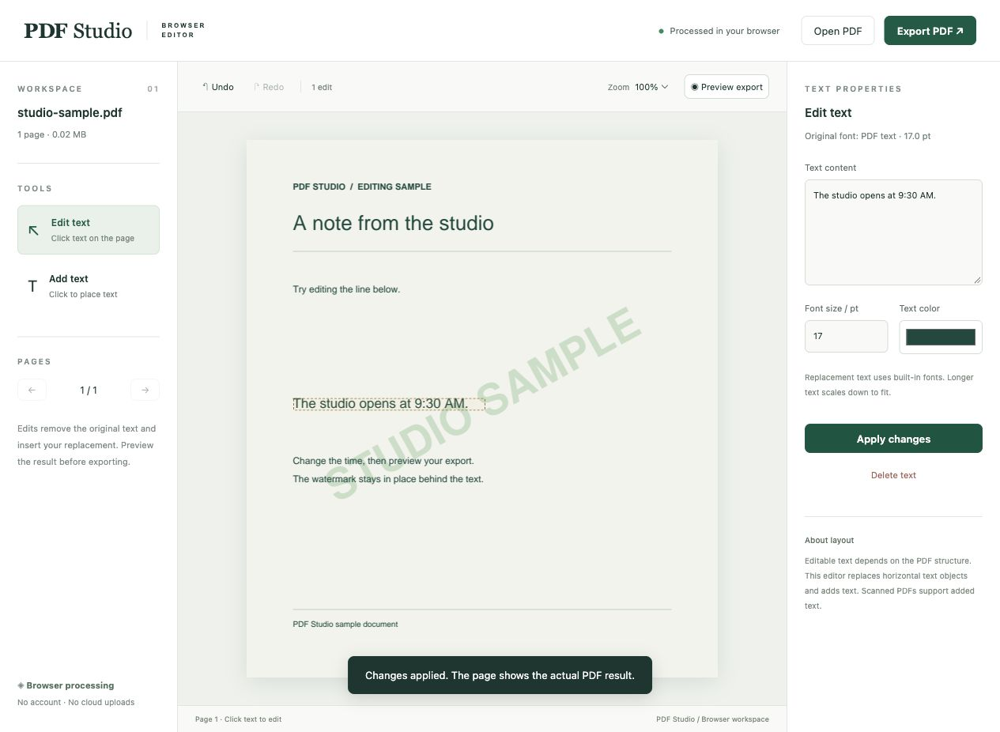

# PDF Studio

**Edit the words. Keep the design.**

PDF Studio is a browser-based workspace for precise PDF text edits. Select text directly on the page, replace it in place, and preview the result against the original artwork before exporting a new PDF.

[**Try PDF Studio online ↗**](https://pdf-studio-online.spunky-loom-3465.chatgpt.site/)



## Try the watermark demo

Choose **Try a sample** to open a studio notice. Change the opening time from **10:00 AM** to **9:30 AM**, apply the edit, then choose **Preview export**. The diagonal watermark remains part of the page in the exported PDF.

## What you can do

- **Edit on the page.** Click an editable text region to replace or delete it. Adjust the size and color, or place new text anywhere on a supported page.
- **Keep the page artwork.** The browser engine removes the selected text object and writes the replacement while retaining images and background graphics.
- **See the exported result as you work.** Apply edits, undo or redo changes, then preview and download a separate PDF.
- **Keep documents on your device.** The online editor uses PDFium and WebAssembly to process files inside your browser. No account or file upload is required.

The online editor accepts PDFs up to 50 MB and 500 pages. Replacement works on supported horizontal text objects and uses built-in fonts. Scanned pages support added text. OCR and paragraph reflow are outside the current editing tools.

## Run from source

### Browser edition

The deployed browser edition is included in `web/dist/`, along with the PDF engine, bundled font, and the watermark sample. Serve the directory with any static web server. For example, from the repository root:

```sh
python3 -m http.server 8765 --bind 127.0.0.1 --directory web/dist
```

Open [PDF Studio on port 8765](http://127.0.0.1:8765/). The browser edition requires no build step.

### Python edition

The Python edition uses PyMuPDF and requires Python 3.10 or newer. From the repository root on macOS or Linux:

```sh
python3 -m venv .env
.env/bin/python -m pip install -r requirements.txt
.env/bin/python app.py
```

On Windows:

```powershell
py -m venv .env
.env\Scripts\python -m pip install -r requirements.txt
.env\Scripts\python app.py
```

Run one edition at a time on port 8765. The Python app opens your browser and keeps document sessions in memory while the server is running. After installing dependencies, you can also launch it with **Start PDF Studio.command** on macOS or **start.bat** on Windows.

## Development and dependency notices

Run `python -m unittest -v` from the installed Python environment. Check the browser modules with `node --check web/dist/app.js` and `node --check web/dist/pdf-engine.js`.

The browser edition includes PDFium via EmbedPDF and the Droid Sans Fallback font. Their license notices are in `web/dist/vendor/`. The Python edition depends on PyMuPDF, which is available under AGPL or a commercial license.
