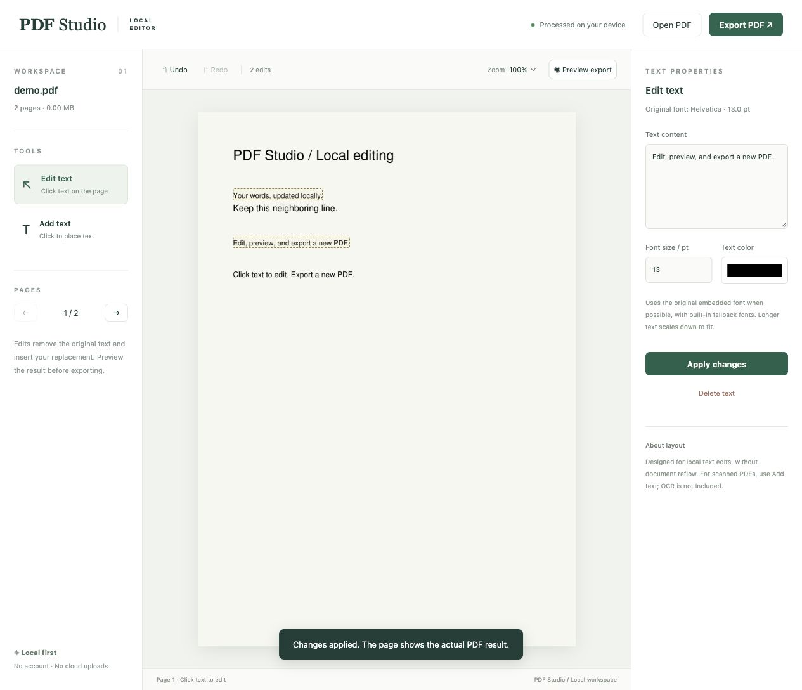

# PDF Studio

A local PDF text editor with a browser interface. Click existing text to replace or delete it, add new text, and export a separate PDF. Documents are processed on your computer, with no account, cloud upload, analytics, or external font requests.

Built with Python, PyMuPDF, and plain HTML/CSS/JavaScript. No frontend build step is required.



## Features

- Click-to-edit text regions, with font size and color controls.
- Add text by clicking a position on the page.
- English and Chinese text support, with embedded-font reuse and built-in fallback fonts.
- Undo and redo for up to 80 operations, including Ctrl/Cmd+Z and Ctrl/Cmd+Shift+Z.
- Page navigation, zoom, and preview of the actual generated PDF.
- Export to a new `filename-edited.pdf`, leaving the original file untouched.
- Loopback-only service, in-memory document sessions, and no remote processing.

## Requirements

Python 3.10 or newer. Installation requires internet access to download PyMuPDF; the app can run offline afterward.

## Quick start

Clone this repository and create a virtual environment:

```sh
git clone https://github.com/luxinyue0910/pdf-studio.git
cd pdf-studio
python3 -m venv .env
```

On macOS or Linux:

```sh
.env/bin/python -m pip install -r requirements.txt
.env/bin/python app.py
```

On Windows (PowerShell):

```powershell
.env\Scripts\python -m pip install -r requirements.txt
.env\Scripts\python app.py
```

The app opens your default browser at **http://127.0.0.1:8765**. Keep the terminal running while editing. Press Ctrl+C to stop the server.

After installing the dependencies, macOS users can double-click **Start PDF Studio.command**. Windows users can double-click **start.bat**.

Optional arguments:

```sh
.env/bin/python app.py --port 8766 --no-browser
```

Use another port if 8765 is already occupied. Open the printed `http://127.0.0.1:PORT` address in Safari, Chrome, Firefox, or another browser. Do not open `static/index.html` directly: the local Python service is required.

## Editing a PDF

1. Choose **Open PDF** or drop a PDF onto the app (up to 50 MB and 500 pages).
2. Click a text region. Change its text, font size, or color in the properties panel, then choose **Apply changes**. Leave the text empty or use **Delete text** to remove it.
3. To insert text, choose **Add text**, click the page, and enter your text. The new region is up to 240 pt wide and 55 pt tall, limited by the page edges.
4. Each applied change rerenders the actual PDF. Choose **Preview export** to hide selection outlines and inspect the result.
5. Choose **Export PDF** to download a new file.

Unapplied input is excluded from export; the app asks you to apply it first. Work is not automatically restored after refreshing or closing the page, so export before leaving.

## How it works

`engine.py` extracts text spans, which are consecutive text fragments with matching formatting. Replacements remove the original text objects and insert new text at the original baseline. Images and vector backgrounds are preserved. Each preview and export replays edits against the original in-memory document, preventing repeated preview operations from accumulating changes.

`app.py` provides the loopback HTTP service, file limits, session storage, and request checks. `static/` contains the English browser interface.

## Limitations

- Intended for localized edits. It does not reflow paragraphs or move neighboring content.
- Embedded fonts are reused when they contain the replacement glyphs. Fallback fonts may differ from the original, and complex typography or spacing may not be reproduced exactly.
- Long single-line text shrinks to fit its original width, down to 4 pt. Multiline text can shrink to 50% of its requested size; content that still does not fit is rejected.
- No OCR or image-text removal. Scanned PDFs support added text, but their original image text cannot be edited.
- Page rotation is normalized. Individual angled or rotated text spans cannot be replaced.
- Some emoji and special symbols are unsupported. Single-line edits with missing glyphs are rejected.
- Unlock password-protected PDFs before opening them. Content changes invalidate existing digital signatures.
- Pages with existing redaction annotations reject text replacement to prevent accidentally applying those annotations.
- This is not a document sanitization tool. Existing metadata, annotations, links, and other content are outside its text-editing scope.

## Privacy and sessions

The server binds only to `127.0.0.1` and checks Host, Origin, and a random per-process API token. Documents are not written to server-side files, and filenames and document IDs are not logged. Up to eight documents are held in memory; opening more evicts the least recently used session. Sessions idle for two hours are removed on the next API request. All sessions disappear when the process exits. Exported downloads remain wherever your browser saves them.

## Development

Run the existing regression tests:

```sh
.env/bin/python -m unittest -v
node --check static/app.js
```

Node.js is optional and is only used above to check JavaScript syntax. Tests cover replacement and deletion, Chinese text, adjacent-content preservation, multiline insertion, rotation handling, invalid input, existing redaction handling, and preview/export rendering consistency. Chinese strings in the test fixtures deliberately verify multilingual document support; the app interface and messages are in English.

Virtual environments, PDFs, temporary output, and local configuration are excluded from version control.

## Dependency licensing

PyMuPDF is available under AGPL or a commercial license. Review its license terms before redistributing or integrating this app into a closed-source product. This repository does not grant a separate open-source license for its application code.
